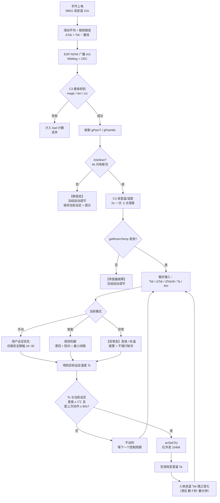

# 智能温控手环 · AI 交接文档

> 版本 2026-11-13 05:57 ｜ 状态：**硬件链路已全部打通，逻辑层待开发**
> 读者：接手本项目的 AI。读完这份就能直接改代码，不需要翻聊天记录。
> 旧的 `docs/项目方案.md`、`docs/开发任务清单.md` 中关于 MAX30205 / DS18B20 / WiFi+HTTP 上报的部分**均已作废**，以本文为准。

---

## 0. 三十秒读懂

**一句话**：手腕测皮温 → ESP-NOW 无线送到 C3 → C3 结合室温决策 → 红外控制奥克斯空调。

**分工红线**：AI 只做硬件驱动、通信、UI、骨架；**温控决策逻辑由学生自己写**，AI 不得代劳，只能给接口、给骨架、给实验方法。

**当前完成度**

| 环节 | 状态 | 实测证据 |
|---|---|---|
| 手环 M601 测温 | ✅ | 22.79~22.85℃，CRC 100%，噪声 σ=0.024℃ |
| 手环屏幕显示 | ✅ | 240×280，大字号分级着色 |
| 手环 → C3 无线 | ✅ | tx 24/24 fail=0；rx 47 包 miss=0 bad=0 |
| C3 室温湿度 | ✅ | 23.2℃ / 58%，fail=0 |
| C3 红外控空调 | ✅ | 实机 23℃→26℃ 成功 |
| 温控逻辑 | ⬜ | 待学生写 |
| 手表 UI（时间/室温） | ⬜ | 下一阶段 T1 |
| SHT30 替换 DHT11 | ⬜ | 器件在途 |

**三条不能动的铁律**

1. S3 的 FQBN 里 `FlashMode=dio`、`PSRAM=opi`，C3 的 `CDCOnBoot=default`。改一个字就可能起不来。
2. 红外发射模块 **VCC 必须 5V**。3.3V 下峰值电流不够，射程 <1m，空调没反应。
3. ESP-NOW 两端**必须在同一 WiFi 信道**（当前固定 ch=1）。任何一端连了路由器，信道会被 AP 改掉，链路立刻断。详见 §2.3。

---

## 1. 硬件

### 1.1 腕端（传感器节点）

| 项 | 型号 / 参数 | 备注 |
|---|---|---|
| 主控 | 微雪 **ESP32-S3-Touch-LCD-1.69** | ESP32-S3R8，16MB Flash，8MB PSRAM(OPI) |
| 屏幕 | ST7789V2，**240×280**，SPI | 面板可见区从 RAM 第 20 行开始（代码里 `YOFF=20`） |
| 触摸 | 板载电容触摸（I2C） | I2C 总线共扫到 4 个器件 |
| 温度传感器 | **敏源 M601**（1-Wire，GPIO17） | 精度 ±0.1℃ 级，不是 DS18B20 |
| 备选温度芯片 | MAX30205（I2C 0x48） | **六组引脚全扫无 ACK，判定模块损坏/未焊，本项目不用** |
| 供电 | 板载锂电接口 + USB-C | 手环形态需接电池 |

**M601 三条必须记住的事**（踩过的坑）

- 家族码 `28h`，指令集与 DS18B20 相同（`CCh` 跳过 ROM / `44h` 转换 / `BEh` 读暂存器），但**温度公式不同**：
  `T = 40 + S_T / 256`（`S_T` 为 int16 补码）。手册里这条公式是**图片**，纯文字提取会漏掉 `+40`，漏了就会读出 -17.7℃。
- presence 判定：本板实测器件在主机释放总线后 **36~40µs** 才拉低，只等 32µs 会漏检。正确做法是释放后**轮询 200µs 窗口**。
- 读时隙采样点取下降沿后 **12µs**（手册 tRDV = 5~15µs）。

### 1.2 中枢端（红外控制器）

| 项 | 型号 / 参数 | 备注 |
|---|---|---|
| 主控 | **ESP32-C3**（4MB Flash，单核 160MHz） | USB 口是 **WCH 转串口桥**（0x1A86），走 UART0(GPIO20/21) |
| 温湿度 | **DHT11**（GPIO6） | ±2℃ / ±5%RH，5 点滑动平均，整数位有效 |
| 温湿度（待换） | **SHT30**（I2C） | 已下单，±0.3℃ / ±2%RH，到货后替换 DHT11 |
| 红外发射 | 红外发射模块 + 发射管（GPIO2） | **必须 5V 供电** |
| 红外接收 | 1838 一体化接收头（GPIO5） | 仅用于自检/录码，非必需 |
| 被控对象 | **奥克斯（AUX）** 空调 | 无遥控器，用手机红外代替 |

### 1.3 引脚总表

**手环 S3**

| 功能 | GPIO | 说明 |
|---|---|---|
| TFT_SCLK | 6 | SPI 时钟 |
| TFT_MOSI | 7 | SPI 数据 |
| TFT_CS | 5 | 片选 |
| TFT_DC | 4 | 数据/命令 |
| TFT_RST | 8 | 复位 |
| TFT_BL | 15 | 背光 |
| M601 DQ | 17 | 1-Wire，开漏输出 |

**中枢 C3**

| 功能 | GPIO | 说明 |
|---|---|---|
| DHT11 DATA | 6 | 右列，避开红外占用的脚 |
| IR_TX | 2 | 接发射模块 DAT |
| IR_RX | 5 | 接 1838 OUT |

### 1.4 供电与接线约束

- 红外发射模块 3.3V 时峰值电流仅 20~40mA，**射程 <1m**；换 5V 后一次成功。这是硬约束。
- DHT11 采样间隔必须 ≥1s（当前 2s）。
- 判断发射管是否工作：**不要看紫光**（940nm 超肉眼极限，手机 IR 截止滤光片也拍不到）；可靠判据是看 1838 接收模块指示灯的 R-G 值（灭 ≈0 / 亮 ≈121）。
- 近距离自检会出现"完美交替"的假象（AGC 饱和），**不能**用来判断发射功率。

---

## 2. 通信

### 2.1 拓扑

```
┌──────────────┐   ESP-NOW 广播 1Hz   ┌──────────────┐   红外 38kHz    ┌────────┐
│ 腕端 S3       │ ───────────────────► │ 中枢 C3       │ ─────────────► │ 奥克斯  │
│ M601 皮温     │   ch1 / CRC16        │ DHT11 室温湿度 │  104bit 帧     │ 空调    │
│ 240×280 屏    │ ◄─────────────────── │ 决策 + 执行    │                └────────┘
└──────────────┘   下行包（T1 待实现） └──────────────┘
```

- 不依赖路由器、不依赖互联网，**断网可用**。
- 当前只有**上行**（手环→C3）。**下行（C3→手环）尚未实现**，而"手环首页显示室温"必须靠它，见 §7-T1。

### 2.2 上行数据包 `WbMsg`（8 字节，packed）

| 字段 | 类型 | 含义 |
|---|---|---|
| `magic` | uint8 | 固定 `0x5A` |
| `ver` | uint8 | 协议版本，当前 `1` |
| `seq` | uint8 | 序号，回绕；接收端用它算丢包 |
| `flags` | uint8 | bit0=1 表示 M601 读数有效 |
| `skinT` | float | 皮温 ℃ |
| `raw` | int16 | M601 原始值（调试用） |
| `crc` | uint16 | 前 6 字节的 CRC（初值 0x1D0F，逐字节异或后循环左移） |

发送：`esp_now_send(广播MAC ff:ff:ff:ff:ff:ff, ...)`，无加密。
接收端校验三项：长度 == 8、magic == 0x5A、crc 匹配；任一失败计入 `bad`。用 `seq` 差值累计 `miss`。

### 2.3 信道陷阱（最容易翻车的地方）

ESP-NOW 跑在 WiFi 物理层上，**收发双方必须在同一信道**。

- 现状：两端都用 `WiFi.mode(WIFI_STA)` 且**不连任何 AP**，信道被 `esp_wifi_set_channel(1)` 固定在 1。
- 一旦手环为了 NTP 校时去连路由器 → 信道跟随 AP（可能是 6 或 11）→ **C3 立刻收不到**。
- 正确解法（T1 采用）：**手环不连 WiFi**。时间由 C3 通过下行包下发（C3 连一次 AP 校时后断开，或直接用编译时间戳 + 手动校时）。若必须连，则两端都连同一 AP 并用 `esp_wifi_get_channel()` 动态同步信道。

### 2.4 奥克斯红外帧（已实测通过）

- **13 字节 / 104 bit**，NEC 风格时序，LSB first。
- 时序：头 `9000µs` mark + `4500µs` space；每 bit `560µs` mark + （`560µs`=0 / `1690µs`=1）space；结尾 `560µs` mark。载波 38kHz。

| 字节 | 内容 |
|---|---|
| `b0` | 固定 `0xC3` |
| `b1` | `(温度-8)<<3 \| 上下风向` |
| `b2` | 固定 `0xE0` |
| `b4` | 风速：`E0`自动 / `60`低 / `20`中 / `A0`高 |
| `b6` | 模式：`20`制冷 / `80`制热 / `C0`送风 / `00`自动 |
| `b9` | 电源：`20`开 / `00`关 |
| `b11` | 按键 ID，实测 `0x06` |
| `b12` | 校验 = 前 12 字节累加和 |

> 校验已 8/8 通过，实机控制成功。**不要重新学码**，码值已定稿在 `firmware/_c3_hub/_c3_hub.ino` 的 `buildFrame()`。

---

## 3. 固件清单与构建

| Sketch | 作用 | 状态 |
|---|---|---|
| `firmware/_wb` | **腕端主力固件**：M601 + 屏幕 + ESP-NOW 上行 | ✅ 已烧录运行 |
| `firmware/_c3_hub` | **中枢主力固件**：DHT11 + 红外 + ESP-NOW 接收 + 对外 API | ✅ 已烧录运行 |
| `firmware/_m601` | M601 纯驱动验证 | ✅ 定稿 |
| `firmware/_aux_send` | 奥克斯帧构造 + 自检 | ✅ |
| `firmware/_ir_learn` | 遥控器录码（内存存 8 条） | ✅ 备用 |
| `firmware/_ui` / `_w1*` / `_probe*` 等 | 历史中间版本 | 归档，勿改 |

**构建（macOS，`source env.sh` 后用）**

```bash
source env.sh
build   _wb        # 只编译 S3
flash   _wb        # 编译 + 烧录 S3（需先手动进下载模式）
buildc3 _c3_hub    # 只编译 C3
flashc3 _c3_hub    # 编译 + 烧录 C3（全自动，免按键）
mon 20 / monc3 15  # 串口监视
python3 tools/mon2.py --secs 20   # 同时看两块板
```

**FQBN（逐字照抄）**

```
S3: esp32:esp32:esp32s3:USBMode=default,CDCOnBoot=cdc,UploadMode=default,CPUFreq=240,FlashMode=dio,FlashSize=16M,PartitionScheme=app3M_fat9M_16MB,PSRAM=opi,LoopCore=1,EventsCore=1,DebugLevel=none
C3: esp32:esp32:esp32c3:CDCOnBoot=default,CPUFreq=160,FlashMode=dio,FlashSize=4M,PartitionScheme=default,UploadSpeed=921600
```

**烧录流程差异（关键）**

- **C3**：USB 口接了 WCH 桥，DTR/RTS 已连 EN/GPIO9，`flashc3` 全程自动。
- **S3**：原生 USB，应用占用了 USB 口，esptool 无法自动复位进下载模式，**必须人手按**：
  按住 BOOT → 短按 RST → 松 BOOT → 端口变成 `usbmodem11301` → 烧录 → **烧完还要再按一次 RST**（`--after hard-reset` 和手动 RTS 序列都无效）。
  新增 `tools/wait_boot.py`：被动等应用口出现后自动抓取 N 秒输出，不碰 DTR/RTS。

**串口工具**：`tools/c3mon.py` 用 `os.open + termios + tty.setraw`，**不碰 DTR/RTS**。用 pyserial 直接开会复位 C3、清空 RAM 里的统计数据。

---

## 4. 对外 API（温控逻辑的唯一入口）

全部在 `firmware/_c3_hub/_c3_hub.ino` §"对外接口"。学生写的逻辑只允许调用这些，不许直接碰红外或 ESP-NOW。

| 函数 | 返回 | 说明 |
|---|---|---|
| `float getSkinTemp()` | ℃ | 手腕皮温；**断链 >8s 返回 `NAN`** |
| `float getRoomTemp()` | ℃ | 室内温度，已含校准偏移 `-1.8℃` |
| `float getRoomHumidity()` | % | 室内相对湿度 |
| `bool linkAlive()` | bool | 手环是否在线（等价 `!isnan(getSkinTemp())`） |
| `void acSet(uint8_t t)` | — | 制冷模式 + 设定 t℃ + 立即发红外（自动限幅 16~30） |
| `void acPower(bool on)` | — | 开 / 关机 |

**串口调试命令**：`16~30`（设温度）、`on`/`off`、`heat <t>`、`fan0~3`、`env`、`cal / cal -1.5`、`p`（打印帧）、`s`（重发）、`h`。

**返回值语义（写逻辑前必须理解）**

```cpp
float tsk = getSkinTemp();
if (isnan(tsk)) {
    // 手环掉线 / 传感器坏 —— 这是"故障态"，不是"冷"
    // 正确做法：冻结自动调节，保持当前空调设定，UI 提示
} else if (isnan(getRoomTemp())) {
    // 室温读失败 —— 同样冻结
} else {
    // 正常态，可以用 tsk 和 getRoomTemp() 做判断
}
```

---

## 5. 智能温控核心流程图



**为什么是"慢闭环"**：人体热惯性大，皮温对**局部**加热的响应 τ≈9s（实测：捏紧手指 22s 涨 10℃），但对**整室环境**改变的响应在分钟级。控制周期取 **60s**，单次最多调 **1℃**，避免空调压缩机频繁启停和体感忽冷忽热。

**四个状态**（骨架代码按此建模）

| 状态 | 进入条件 | 行为 |
|---|---|---|
| `MANUAL` | 用户手动设定 | 用户说了算，只做 16~30 限幅 |
| `AUTO` | 用户切智能 | 按判据自动调，受滞回/间隔/步长约束 |
| `ALARM_FEVER` | 皮温持续高于自身基线且室温不高 | 报警，**不**执行制冷降温（不是中暑就别吹） |
| `ALARM_HYPO` | 皮温持续低于自身基线且室温不低 | 报警，停冷风 / 升温 |
| `LINK_LOST` | 8s 无包 | 冻结自动，保持现状，UI 提示 |

---

## 6. 已验证结论与已知限制

**已实测数据**

| 项目 | 结果 |
|---|---|
| M601 读数 | 与标准温度计一致，23.25℃ 对齐；CRC 30/30 |
| M601 噪声 | σ=0.024℃，峰峰值 0.06℃ |
| 手环→C3 链路 | 1Hz，rx=47 / miss=0 / bad=0 |
| 皮温对捏紧手指的响应 | τ≈9s，22s 升 10℃ |
| 皮温对虚捂（非接触）的响应 | τ≈42s |
| 手腕体表稳态 | 35.4℃（**注意：这是体表温度，不是核心体温 37℃**） |
| DHT11 与 M601 偏差 | 高 1.77℃，已用 `-1.8` 校准补偿 |
| 红外控制 | 实机 23℃ → 26℃ 成功 |

**已知限制（写论文/答辩必须如实说明）**

1. **手腕皮温 ≠ 核心体温**。正常手腕皮温 32~34℃，核心 36.5~37.5℃。因此发烧判定只能用"相对自身基线的偏移"，**不能**用绝对值，也**不能**做医疗诊断，只能做"异常提示"。
2. DHT11 分辨率 1℃、精度 ±2℃，是靠软件校准硬凑的；SHT30 到货后应替换。
3. 手环烧录必须手动按键，尚无 OTA。
4. 空调无状态回读（红外是单向的），系统只能"假设"指令已执行。若空调被遥控器改过，会失同步 —— 缓解办法：每次调整都发完整帧，而非增量帧（当前已如此）。
5. 单房间、单空调、无风感/辐射温度测量。

**踩坑清单（省得重走）**

| 症状 | 真因 | 解法 |
|---|---|---|
| M601 读 -17.7℃ | 公式漏 `+40` | `T = 40 + raw/256` |
| M601 时好时坏 | presence 只等 32µs | 轮询 200µs 窗口 |
| DHT11 fail=38 乱跳 | 中断打断位时序 | 整段 `noInterrupts()` |
| C3 串口全静默 | `CDCOnBoot=cdc` 把 Serial 映射到原生 USB | 改 `default` |
| C3 分区表校验失败 | FlashMode / 需整片擦 | `erase_flash` + 分段烧 + `dio` |
| 空调没反应 | 发射模块 3.3V 功率不足 | VCC 改 5V |
| 手环烧完不启动 | 硬复位无效 | 人手再按一次 RST |

---

## 7. 下一步任务清单

### T1 · 刷微雪官方智能手表固件（首页：时间 + 皮温 + 室温）

**目标**：屏幕首页像一个手表 —— 大字号时间居中，皮温、室温小字号上下排布，底部状态栏。

**必须先做的隐藏前提**：室温只有 C3 有，手环要显示就必须有**下行链路**。

**子任务**

| # | 内容 | 要点 |
|---|---|---|
| T1.1 | 新增下行包 `HubMsg`（C3→手环，1Hz 广播） | 字段：`magic,ver,seq,roomT,roomRH,acSet,acOn,epochSec,crc`。C3 侧 `esp_now_add_peer` 广播地址后 `esp_now_send` |
| T1.2 | 时间源 | **不要**让手环连 WiFi（会改信道断链）。由 C3 连一次 AP 做 NTP，把 `epochSec` 通过下行包传过去；手环用 `millis()` 外推。C3 无 WiFi 时退化为"编译时间 + 手动校时命令" |
| T1.3 | 官方表盘移植 | 微雪官方例程在 wiki 的 ESP32-S3-Touch-LCD-1.69 页面。只取**版面与配色**，驱动仍用现有手写 ST7789 代码（已验证可用，别换）|
| T1.4 | 布局 | 240×280，`YOFF=20`。时间 48px 级，皮温 32px 级，室温 16px 级 |
| T1.5 | 离线降级 | 下行断链时室温显示 `--`，时间继续用 `millis()` 外推，不要让整屏停摆 |

**验收**：断电重启 3 秒内出表盘；时间与手机误差 <2s；室温与 C3 串口 `ENV` 一致；拔掉 C3 后 8 秒内室温变 `--` 且不崩。

---

### T2 · 智能温控 UI 界面

**目标**：手环上能看、能切、能设。

| 区域 | 内容 |
|---|---|
| 顶部 | 当前状态徽标：`AUTO` 绿 / `MANUAL` 灰 / `ALARM` 红闪烁 / `LINK LOST` 黄 |
| 中部 | 皮温大数字 + 30 分钟趋势曲线（60 点，5×7 点阵自绘） |
| 下部 | 室温 / 湿度 / 空调当前设定温度 / 目标温度 |
| 触摸 | 左滑：手动 ±1℃；右滑：切 AUTO/MANUAL；长按 3s：静音报警 |

**要点**

- 触摸（CST816 类）走 I2C，注意与 M601 的时序错开（M601 是 1-Wire 位操作，读的时候关中断，触摸读取要避开这 5ms）。
- 温度分级着色沿用现有规则：`<25℃` 青 / `25~32℃` 绿 / `32~37.5℃` 黄 / 其它 红。
- 报警必须在**屏幕**和**串口**双通道输出，不要只靠声音（教室环境吵）。

**验收**：五个界面元素都能实时刷新不闪烁；触摸滑动不误触；切模式后 C3 串口能立刻看到对应状态行。

---

### T3 · 温控骨架代码（逻辑留空，学生填）

**建议文件**：`firmware/_c3_hub/control.h` + `control.cpp`（C3 侧，单核，不要开任务）。

**骨架必须包含**

```cpp
enum Mode { MANUAL, AUTO, ALARM_FEVER, ALARM_HYPO, LINK_LOST };
enum CtlState { ST_NORMAL, ST_COOLING, ST_WARMING, ST_HOLD };

void ctrlInit();
void ctrlLoop(uint32_t now);   // 由 loop() 调用，内部自己限频 60s
void ctrlSetMode(Mode m);
Mode ctrlGetMode();

// —— 以下四个判据由学生实现，骨架里只有签名和 TODO ——
bool ctrlIsFever(float tsk, float baseline, float roomT);
bool ctrlIsHypothermia(float tsk, float baseline, float roomT);
int  ctrlDecideTarget(float tsk, float baseline, float roomT, float rh);
void ctrlAlarm(const char *what);
```

**骨架已经实现好、学生不要改的部分**

- 60s 控制周期、单次 ±1℃ 步长、目标限幅 24~28℃、动作最小间隔
- 皮温滑动平均（窗口 10 点 = 10s）与基线维护（启动后 10 分钟不计入基线）
- `NAN` 保护、断链保护、状态机迁移
- 手动模式下只做限幅，不干预用户
- 报警去抖（连续 3 次判据成立才报）

**验收**：填四个函数就能跑；不填也能编译通过、进入 `MANUAL` 不崩；串口有 `CTL: mode=AUTO tsk=33.1 base=32.4 room=26.0 target=26 act=HOLD` 这样的单行日志。

---

### T4 · 待采购 / 待验证

| 事项 | 说明 |
|---|---|
| SHT30 到货替换 DHT11 | 改 `sampleEnv()`，I2C 读，保留 `getRoomTemp()` 签名不变；替换后重新标定 `gTempOffset` |
| 手环电池续航 | 测 1Hz ESP-NOW + 常亮屏的实际电流，估算续航 |
| 多空调兼容 | 当前只针对奥克斯；换品牌需重新录码 |

---

## 8. 文件地图

```
ESP32/
├── env.sh                       # 环境 + build/flash/buildc3/flashc3/mon/monc3
├── firmware/
│   ├── _wb/                     # ★ 腕端主力
│   ├── _c3_hub/                 # ★ 中枢主力（含对外 API）
│   ├── _m601/  _aux_send/  _ir_learn/
│   └── _ui/ _w1*/ _probe*/      # 历史归档
├── tools/
│   ├── c3mon.py                 # 单板监听（不碰 DTR/RTS）
│   ├── mon2.py                  # 双板同时监听
│   └── wait_boot.py             # 等 S3 进应用模式并自动抓日志
├── data/                        # sensitivity.csv / step2.csv / aux_frames_raw.txt
├── docs/                        # 本文件 + 汇报稿 + （旧文档）
└── build/                       # 编译产物
```
